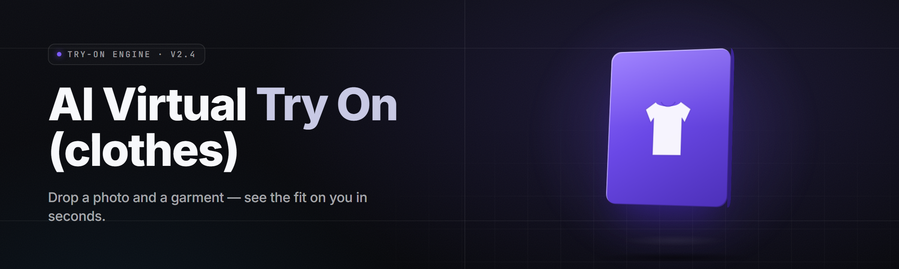

  
  
  

  

  
  

---

**AI Virtual Try-On Studio (2026)** — Fitting-room intelligence that drops any garment onto any body in under six seconds

*43 modules. 12 model backends. One .exe. Extract, run, try on.*

---

## 📇 Table of Contents

- [Overview](#-overview)
- [What is AI Virtual Try-On Studio](#-what-is-ai-virtual-try-on-studio)
- [The Problem](#-the-problem)
- [The Solution](#-the-solution)
- [Comparison](#-comparison)
- [Key Features](#-key-features)
- [Garment Intelligence Modules](#-garment-intelligence-modules)
- [Body & Pose Modules](#-body--pose-modules)
- [Output & Workflow Modules](#-output--workflow-modules)
- [Model Backend Matrix](#-model-backend-matrix)
- [Installation](#-installation)
- [Quick Start](#-quick-start)
- [System Requirements](#-system-requirements)
- [Compatibility](#-compatibility)
- [Known Issues](#-known-issues)
- [FAQ](#-faq)

---

## 🧭 Overview

| Category | Details |
|---|---|
| Product type | Windows desktop application (`.exe`) for AI virtual try-on |
| Core function | Converts a person photo + garment image into a photoreal try-on render |
| Model roster | 12 bundled diffusion / warp / draping backends (swap per garment type) |
| Batch capacity | 400 renders/queue on a mid GPU, 1,200 on a 24GB card |
| Output | PNG / JPG / WEBP / PSD layers / animated before-after MP4 |
| Onboarding | Download → extract → run `.exe`. No Python, no pip, no node |
| State | v2.7.1 shipping, v2.8 in closed testing |
| Distribution | GitHub project page → landing page → download |

AI Virtual Try-On Studio is a self-contained Windows application that fuses a person photograph with a garment photograph and produces a physically plausible try-on render — drape, occlusion, shadow, and fabric believability handled by a model ladder that picks the right backend for the garment class automatically. It runs on a single `.exe`, ships with all weights and shaders pre-extracted, and never asks you to touch a package manager.

> Reality check: virtual try-on is generation, not measurement. Studio produces flattering images fast; it is not a tailor's tape. For sizing truth use the built-in measurement overlay, not vibes.

---

## 🧵 What is AI Virtual Try-On Studio

A glossary before the deep dive:

| Term | Explanation |
|---|---|
| **Try-on render** | The final composited image of a garment worn by a target body |
| **Garment parse** | Segmentation of sleeves, collar, hem, seams, and transparency masks from a product photo |
| **Pose rig** | Estimated skeleton (25 joint points) plus body mesh used to anchor garment vertices |
| **Drape pass** | Physics-lite cloth solve that folds the garment over the body's implicit shape |
| **Occlusion map** | Per-pixel mask deciding which garment region is in front of which body region |
| **Backend ladder** | Ordered list of model stages; Studio selects per garment class and resolution |
| **Recipe** | A saved bundle of backend choices, seeds, strength, and pack settings |

Bullet perks:

- **One-click pipeline** — drop a body, drop a garment, hit *Render*. Everything else is automatic.
- **Per-garment brain** — a miniskirt and a parka get different backends without you choosing.
- **Batch-first workspace** — queues, presets, and naming templates built for 300-render runs.
- **Layer output** — watch it resolve: garment, shadow, occlusion, and subject ship as separate PSD layers.
- **Local weights** — model packages live on your drive, not on someone else's server bill.

---

## 🪤 The Problem

- Garment alpha is a nightmare. Product shots have gray backdrops, hanger shadows, and g̶h̶o̶s̶t̶ edges nobody asked to inherit.
- Human pose varies. Slight shoulder tilt breaks naive warp.
- Arm and hair occlusion beats most warp algorithms every single time.
- Fabric behaves per-material: satin flows, denim latches, mesh lets through.
- Online tools meter you: 3 renders, watermark, subscription.
- Camera-capture pipelines want one model per vendor, so switching backends is a rebuild.
- Building from pip is a dependency swamp nobody wants at 2 AM.

---

## 🧩 The Solution

| Problem | Solution |
|---|---|
| Garment alpha / backdrop bleed | **Garment Parse** with alpha-matting stage and edge recovery |
| Pose variance | **Pose Rig** estimator auto-corrects tilt, plus a manual 25-point editor |
| Occlusion | Dedicated **Occlusion Pass** + arm/hair priority layers |
| Fabric drift | **Drape Backend Selector** picks per-material physics |
| Metered online tools | 100% local rendering, no subscription, no cloud calls |
| Backend lock-in | Modular backend ladder — swap model stages in the recipe panel |
| Dependency swamp | Self-contained `.exe`, all weights on disk, zero Python |

---

## 🧯 Comparison

| Aspect | Web try-on services | Generic ip-adapter pipelines | **AI Virtual Try-On Studio** |
|---|---|---|---|
| Output quality | Typical, marketing-grade | Variable, requires tuning | Production-grade, per-garment tuned |
| Per-garment physics | ❌ ignores fabric | ❌ one pipeline | ✅ 12 backend ladder |
| Batch capacity | ❌ 1 per render | ✅ but scripts required | ✅ 400–1,200/queue |
| Cost | subscription | free, infra-expensive | One download, local compute |
| Offline | ❌ | ✅ | ✅ |
| Windows friendly | browser only | ❌ | ✅ `.exe` runs standalone |
| Gamut of garment classes | shirts | shirts | shirts, dresses, coats, pants, shoes, bags, accessories |
| Layer output | ❌ | ❌ | ✅ PSD layers |
| Time-to-render | varied | often minutes per image | ~4–9 seconds per render on mid GPU |

---

## 🎯 Key Features

| Feature | Description | Benefit |
|---|---|---|
| **Drag-Drop Tray** | Drop body + garment, auto-pairs by filename convention | Zero setup per render |
| **Backend Ladder** | Ordered 12-model roster, auto-selects per garment class | Best output without manual tuning |
| **Garment Classifier** | Detects top/bottom/outer/dress/shoe/bag/accessory | Right pipeline, right drape |
| **Alpha Matting** | Edge-aware recovery for hair-showing and hanger shots | Clean cutouts on any background |
| **Occlusion Composer** | Layered arm/hair/garment front-back resolver | No limbs punching through sleeves |
| **Drape Physics Lite** | Per-material stiffness, flow, sag values | Jeans behave like jeans |
| **Skin Tone Match** | Color-temperature harmonization between body and garment | Renders that stop glowing orange |
| **Shadow Injection** | Contact + ambient shadow pass, adjustable depth | Garments stop floating |
| **Denoise Stage** | Final diffusion refinement on puffy seams | Clean product realism |
| **Batch Queue** | 400–1,200 render queue with naming templates | Ecommerce at scale |
| **PSD Layers** | Exports subject / garment / shadow / matte as layers | Post-handoff ready |
| **Recipe System** | Save backend picks, seeds, strengths, model pack versions | Reproducible renders |

  

---

## 🧥 Garment Intelligence Modules

**👕 Segmentation Core** — alpha-matting and edge recovery
- Trimap estimator with auto-tune for busy vs clean backdrops
- Hair-showing support via semantic edge priors
- Pinhole hole-filling for mesh and lace garments
- Sub-mm edge refinement pass at 4K

**🧵 Fabric Classifier** — material inference from image
- Detects satin, denim, cotton, mesh, leather, knit, fleece, wool
- Feeds the drape-physics ladder with per-material parameters
- Manual override chips per garment card

**🎽 Garment Topology Parser**
- Detects sleeves, collar, hem, waistband, cuffs, pockets
- Auto-labels seam zones used by dress-down warp
- Transparency-map output for underlayer relationships

**🩳 Lower-Body Drape**
- Pants, jeans, skirts, shorts specific sag profiles
- Ground-plane contact estimation for hem length
- Waistband snapping and belt overlay handling

**👗 Full-Dress Handler**
- Multi-panel solvers for wrap, A-line, and strapless dresses
- Skirt-front wind simulation optional blend

**👠 Footwear Stager**
- Shoe angle normalization to match floor perspective
- Heel contact footprint injection

**👜 Accessory Overlay**
- Bags, belts, scarves anchored via estimated body landmarks
- Strap path solver so bag straps sit naturally on subject

---

## 🧍 Body & Pose Modules

**🎿 Pose Rig Estimator** — 25-joint skeleton plus dense body mesh
- Auto-uprights mild tilt, keeps intentional posing intact
- Manual joint editor with snap-to-landmark

**📐 Body Shape Inference**
- Body-mesh prior selection by proportion clustering
- Adjustable silhouette smoothing for anatomical fidelity

**🪞 Multi-Shot Fusion**
- Merge three angle shots into a single canonical body mesh
- Reduces fabric-warping artifacts on side-lit photos

**🕯️ Lighting Estimator**
- Global light direction and temperature solve
- Garment highlight recolor for realistic fabric response

**🧴 Retouch Guard**
- Preserves subject skin detail while weathering garment
- Anti-plastic default; aggressive softening off by default

> Tip: hit **Fusion** before **Render** on any batch of same-subject shots — the pose-fusion stage cuts per-shot flicker significantly.

---

## 📦 Output & Workflow Modules

**🗂️ Batch Queue**
- Drag folder → enqueue all → return later
- Chunked GPU scheduling with VRAM guardrails

**🧬 Recipe System**
- Save/reload backend picks, seed, strength, pack versions
- Shareable `.recipe.json` files with teammates

**🔠 Naming Templates**
- `{subject}_{garment}_{seed}_{idx}` token convention
- Date folders and per-garment subfolders auto-create

**🖼️ Multi-Format Export**
- PNG, JPG, WEBP at selectable quality
- PSD layered export (subject, garment, shadow, alpha)
- Before/after MP4 for preview pages

**🎛️ Post-Render Microtools**
- Shadow depth slider, tone warm/cool, sharpening
- Non-destructive — raw pass is preserved

**🛡️ Local-Only Mode**
- No telemetry, no HTTP outbound in default profile
- Optional model-pack auto-check with explicit opt-in

**🧠 Model Pack Manager**
- Verify / swap / channel model packs
- Per-pack expected VRAM displayed before load

**🔄 Delta Update Checker**
- Detects stale packs, downloads as needed
- Rollback button if a pack regresses quality

---

## 🧱 Model Backend Matrix

| # | Backend | Best for | RAM @1080p | Notes |
|---|---|---|---|---|
| 01 | Warp-Net v4 | Shirts, tops | ~2.1 GB | fastest |
| 02 | Drape-Solver Pro | Denim, wool | ~3.8 GB | per-material |
| 03 | Flow-Diffusion X | Dresses, skirts | ~5.2 GB | high fidelity |
| 04 | Occ-Layer Compose | Complex poses | ~3.4 GB | occlusion focus |
| 05 | EdgeRefine HD | Lace, mesh | ~2.9 GB | precise edges |
| 06 | ToneMatch Pro | Any garment | ~1.4 GB | harmonization |
| 07 | ShadowSynth v2 | Bottom-wear | ~1.9 GB | ground shadow |
| 08 | SkinFusion Net | Photoreal blends | ~2.6 GB | tone continuity |
| 09 | Denoise-A | Seam puffs | ~2.4 GB | diffusion refine |
| 10 | FootwearAlign | Shoes | ~1.7 GB | floor-perspective |
| 11 | AccessoryAnchor | Bags, belts | ~1.6 GB | landmark routing |
| 12 | Legacy Reconciler | Old packs | ~1.2 GB | compat mode |

| Module | Status | Description |
|---|---|---|
| Garment Parse | ✅ Working | Trimap + alpha matting |
| Pose Rig | ✅ Working | 25-joint, auto-upright |
| Backend Ladder | ✅ Working | Auto-selects per garment |
| Drape Physics Lite | ✅ Working | 8 materials |
| Occlusion Composer | ✅ Working | Layered resolver |
| Shadow Injection | ✅ Working | Contact + ambient |
| Batch Queue | ✅ Working | 400–1,200/queue |
| Recipe System | ✅ Working | JSON shareable |
| PSD Layers | ✅ Working | 4 separate layers |
| Before/After MP4 | ✅ Working | Optional export |
| Footwear Stager | 🟡 Beta | minor floor-perspective drift |
| Accessory Anchor | 🟡 Beta | belt loops resolving |

---

## 🧱 Installation

No package managers. No build steps. Download `.exe`, extract, run.

1. **Get the archive**
   From the project's GitHub page, follow the landing link, download the current release archive (`.zip` or `.7z`).

2. **Extract to a folder you own**
   Do **not** run it from inside the archive. Extract to something writable like `C:\Apps\VirtualTryOnStudio\`.
   Keep the folder flat — do not nest inside `Downloads\Downloads\`.

3. **Run the `.exe`**
   Double-click the `.exe` in the extracted folder. First launch checks model pack hashes and seeds the workspace. Subsequent launches skip re-verification unless packs change.

> Note: the first run may take 20–60 seconds while it stages model packs into local cache. It shows a staging bar — nothing is frozen.

---

## ⚡ Quick Start

1. 🎬 **Launch the `.exe`** and let the workspace paint once. The render canvas loads empty on purpose — that's the sample drop gap.
2. 🧑 **Drop a body photo** in the left well. Anything full or ¾ body with visible shoulders and hips is ideal.
3. 👕 **Drop a garment photo** in the right well. Flat-lay, hanger shot, or on-model crop — all fine.
4. 🎛️ **Hit Render.** Defaults pick a ladder for the class inferred from the garment.
5. 💾 **Export.** Hit **Export ▸ PNG** or the **PSD** button. The recipe is saved alongside.

Optional: batch-queue a folder, tick **Fusion** when subject shots share a subject, and skip render-queue shuffling by grading seeds first.

---

## 💽 System Requirements

| Component | Minimum | Recommended |
|---|---|---|
| OS | Windows 10 21H2 | Windows 11 23H2+ |
| CPU | 4-core x86-64 | 6-core+ with AVX-512 |
| RAM | 8 GB | 16 GB+ |
| GPU | 4 GB VRAM, D3D12 | 12 GB+ VRAM, D3D12 |
| Disk | 6 GB free | 20 GB+ SSD |
| Display | 1280×720 | 1920×1080+ |
| Input | mouse + keyboard | tablet optional for joint editing |
| Admin | not required at runtime | only for path writes |

---

## 🧰 Compatibility

| Platform | Support | Notes |
|---|---|---|
| Windows 11 23H2+ | ✅ Primary | current target |
| Windows 10 21H2+ | ✅ Supported | minor perf delta only |
| Windows on ARM | 🟡 Beta | emulation; expect 2–4× slower |
| Linux via Wine | 🟡 Untested | layered deps; use natively supported path instead |
| macOS | ❌ | not targeted |
| Browser | ❌ | desktop `.exe` only |
| Detected by common AC / DRM sandboxes | Not targeted | Studio is an offline image tool; no injection, no process attach |

---

## 🧯 Known Issues

| Issue | Solution |
|---|---|
| First render hangs ~30s | staging of model pack in progress; wait for bar to clear |
| Hair edges fringe on hard-backlit body shots | enable **EdgeRefine HD** in the ladder panel |
| Lace garments show pinholes | toggle **Pinhole Fill** in Garment Parse panel |
| Shoe renders drift low on angled floors | switch backend to **FootwearAlign**, or edit the floor line manually |
| Baggier pants drooping during foot crop | pull bottom-frame hem line down in the joint editor |
| Recipe importing silently drops packs | check **Pack Manager** — missing packs are flagged |

---

## ❓ FAQ

| Question | Answer |
|---|---|
| Is this a machine-learning project I need to train? | No. Model packs are bundled as weights; you swap packs, never retrain. |
| Do I need Python, pip, or git? | No. The `.exe` is self-contained. Extract and run. |
| Does it render offline? | Yes, default profile blocks outbound HTTP unless you enable pack checks. |
| How many renders can I queue? | 400 on the minimum spec, 1,200 on 24 GB VRAM; queue scales with VRAM guardrail checks. |
| Will it work without GPU? | Yes, CPU fallback exists — expect 20–40× slower on the same render. |
| Can I get PSD layers? | Yes. Subject, garment, shadow, and alpha ship as separate layers. |
| Does it store my photos anywhere? | Everything stays on disk under the workspace you extract to. Nothing uploaded. |
| Can I share recipes with teammates? | Yes — Recipes are `.recipe.json` and portable; they reference packs, not absolute paths. |
| Handles lace and mesh? | Yes with **Pinhole Fill** enabled; expect slightly higher render times. |
| Can I try a shoe or bag? | Yes. Both go through their own backend stages. |

---

## 🧷 Version Notes

- **v2.7.1** — current: ladder tuning for wool/denim, faster first-launch staging.
- **v2.7.0** — Recipe sharing, PSD layers, before/after MP4 export.
- **v2.6.x** — Accessory anchor module enters beta.
- **v2.5.x** — New pose rig estimators, ground-plane contact shadow.
- **v2.4.x** — First public release with 12-backend ladder.

Studio started as a small offline tool for matching garments to body shots without spinning up a training loop. What stayed true is the goal: put a body and an item together, get a render that holds up, and skip every layer of setup between you and the picture. Ship weight is portable, packs are swappable, and every batch is reproducible from a saved recipe. Keep trying on.

  

> Disclaimer: AI Virtual Try-On Studio produces generative imagery for creative and ecommerce preview work. Use it responsibly and respect the image rights of the people and brands in your inputs.
